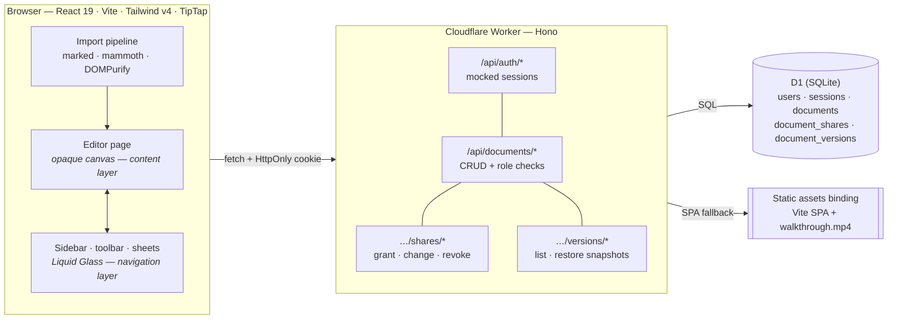
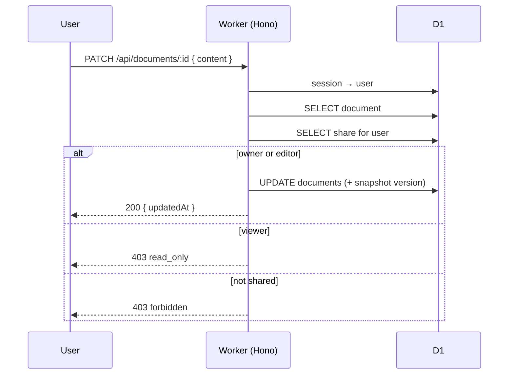

# Architecture note

**Ajaia Docs** — a lightweight collaborative document editor.
Live: <https://ajaia-docs.alessio-2b5.workers.dev>

---

## 1. What I optimised for

The brief was open-ended, so the first decision was *what not to build*. I picked one slice
and went deep on it:

| Surface | Decision | Why |
| --- | --- | --- |
| Editing | TipTap (ProseMirror) with the formatting a shared doc actually needs | Weeks of editor work is not where the product risk is; the risk is in persistence and access control. |
| Persistence | Cloudflare D1 (SQLite) | One database, zero config, free tier, and it works identically for local dev (`node:sqlite`) and production. |
| Sharing | Owner + editor/viewer roles, enforced server-side | The brief asked for "clear intent and working logic" — a role matrix the API enforces is that logic. |
| File upload | Import → new editable document (`.md`, `.txt`, `.docx`) | Import is more useful than attachment: it lands the user directly in an editable document. |
| Auth | Mocked — seeded accounts, session cookie | Real auth would have consumed the time budget that the editor, sharing and deployment needed. The *authorisation* layer is real. |
| Deployment | Cloudflare Workers + static assets binding | One deploy, one origin, no CORS, no second service to operate. |

**Explicitly out of scope:** real-time collaboration (CRDT/OT), comments/suggestions, a
character-level diff view, PDF export, org-wide sharing, full-text search across bodies,
offline editing.

## 2. Shape of the system



Two backends, one code path. `src/server/db.ts` exposes a three-method interface
(`all` / `first` / `run`); the D1 adapter and the `node:sqlite` adapter implement it, and all
SQL uses positional `?` parameters so the exact same statements run in both places. That is why
the test suite can exercise the real application code against an in-memory database.

> Static render of the same diagram: [`docs/architecture.svg`](docs/architecture.svg)
> (regenerate with `node scripts/render-diagram.mjs`).

### The authorisation path, end to end

Every write takes the same route through the system:




## 3. Data model

```
users(id, email UNIQUE, name, color, created_at)
sessions(token PK, user_id → users, created_at)
documents(id PK, owner_id → users, title, content, plain_text, created_at, updated_at)
document_shares(document_id → documents, user_id → users, role CHECK(editor|viewer), created_at)
document_versions(id PK, document_id → documents, user_id → users, content, excerpt, created_at)
```

`documents.content` stores **semantic HTML**, not editor JSON. HTML keeps three properties I
wanted: the document survives a change of editor or schema, a reviewer can read it without the
app, and the server can enforce a byte-size limit without understanding the document format.
The editor schema is the real sanitizer — TipTap parses stored HTML against its own schema, so
unknown nodes and marks are dropped on load.

The schema is not duplicated in code: `src/server/schema.ts` reads every file in `migrations/`
in order, so local dev and the test suite build exactly the tables `wrangler d1 migrations
apply` creates. A migration added to that folder is picked up by both — there is no second
copy of the schema to forget to update.

## 4. The access model (the part that carries the risk)

One function decides everything:

```ts
accessFor(documentId, user) →
  { ok: true, doc, role: 'owner' }      // owner
  { ok: true, doc, role: 'editor' }     // shared, can edit
  { ok: true, doc, role: 'viewer' }     // shared, read only
  { ok: false, status: 403 }            // no access
```

Every route goes through it, and the role then gates the operation:

| Operation | owner | editor | viewer | non-sharee |
| --- | --- | --- | --- | --- |
| read | ✅ | ✅ | ✅ | 403 |
| edit content / title | ✅ | ✅ | 403 `read_only` | 403 |
| grant / change / revoke access | ✅ | 403 | 403 | 403 |
| delete document | ✅ | 403 | 403 | 403 |
| read version history | ✅ | ✅ | ✅ | 403 |
| restore a version | ✅ | ✅ | 403 `read_only` | 403 |

The UI mirrors the rules (toolbar disabled, read-only banner, owner-only affordances), but the
UI is never the enforcement point. The vitest suite asserts the whole matrix, including that a
viewer gets `403 read_only` rather than a silent success.

## 5. Editing experience

- **Toolbar** mirrors Apple HIG: borderless icon buttons, active state as an accent tint, one
  *Format* menu for text styles (paragraph / H1–H3) instead of three separate buttons.
- **Autosave**: content changes are queued and flushed 700 ms after the last keystroke; the
  queue is also flushed when the tab is hidden and before switching documents. The header shows
  `Saving… / Saved / Save failed` — failure is visible rather than silently swallowed.
- **One save queue per document.** Pending edits are tracked by document id
  (`src/client/lib/saveQueue.ts`), so a failed save is always retried against the document it
  came from — never against whichever document the user happens to be looking at when the
  retry fires.
- **Optimistic concurrency was deliberately skipped.** Last-write-wins is acceptable for a
  demo; adding version checks without real-time sync would have added half a feature.
  It is the first thing I would add (see §8).
- **Version history**: the API snapshots the content whenever a `PATCH` changes it, and the
  `⋯` menu → *Version history* lists those snapshots (author, age, text preview) with a
  **Restore** action. Two details make it usable rather than noisy:
  - *Autosave fires often*, so snapshots inside a 15-second window collapse into one — the
    history shows checkpoints, not keystrokes. The newest 30 are kept; older ones are pruned.
  - *A restore is itself a version.* Restoring writes the snapshot back to the document and
    records it as a new snapshot, so the history always shows how the document got to where
    it is now.

  The snapshot rule lives on the server, so it holds for every client — and the panel is
  read-only for viewers, because restoring is a write.

## 6. Design system

Apple's Human Interface Guidelines, implemented as CSS custom properties in
`src/client/styles.css`:

- semantic colours (label/background/separator/fill/accent/destructive) with light **and** dark
  values, swapped by `prefers-color-scheme`;
- Apple text styles (body 17/22, title 28/34, …) mapped onto Tailwind v4 theme tokens;
- **Liquid Glass** for the navigation layer only — floating sidebar, unified toolbar, sheets and
  popovers — approximated with tint + `backdrop-filter: blur() saturate()` + inset highlight +
  drop shadow. The document canvas stays opaque, because Apple's guidance is explicit that glass
  belongs to the layer floating above content, and glass-on-glass is avoided;
- accessibility fallbacks: `prefers-reduced-transparency` and `prefers-contrast: more` collapse
  the glass to solid surfaces, `prefers-reduced-motion` removes transitions, and coarse pointers
  get 44 pt hit areas.

## 7. Verification

| Check | Command / method | Result |
| --- | --- | --- |
| Types | `npm run typecheck` | clean |
| Behaviour | `npm test` (vitest) | 22/22 — auth, persistence, role matrix, validation, version history |
| API, live | `curl` against the deployed Worker | login → create → patch → read-back → share (editor + viewer) → editor writes but cannot delete or re-share → viewer gets `403 read_only` → owner-only revoke → versions list + restore → `413` over 1 MB |
| UI, live | Playwright run of the real flow | sign-in → edit → autosave → import → share → switch user |
| Persistence | reload the page mid-flow | content returns from D1 |
| Design | screenshots reviewed at 1440×900, light and dark | — |

## 8. Known limits, and what I would build next

**Limits (honest list):** mocked auth (no passwords, no email verification, no CSRF token, no
rate limiting, no audit trail); last-write-wins editing (two people typing in the same document
can overwrite each other); import capped at 1 MB and limited to `.md` / `.txt` / `.docx`;
no attachment support; `.docx` import is best-effort (mammoth drops exotic Word features);
the share picker lists seeded accounts only, not a directory; version history stores full
snapshots, so a large document with many versions costs real storage, and there is no
character-level diff — only a text preview of each snapshot.

**Next 2–4 hours, in order:**

1. **Conflict handling + presence.** A `version` column on `documents` with `If-Match`-style
   rejection, a "someone else edited this" banner, and a lightweight presence channel
   (Workers Durable Objects or a simple SSE endpoint) showing who is in the document.
2. **Real auth.** Passwordless e-mail or OIDC, `SameSite=Strict` + CSRF token, per-user rate
   limiting, and an `audit_log` table recording share grants and revocations.
3. **Version history, second half.** A character-level diff between a snapshot and the current
   text, and named versions ("Q3 draft") on top of the automatic ones.
4. **Attachments.** R2 bucket + presigned uploads, attachments panel in the document header.
5. **Export to PDF** via the browser print stylesheet, and Markdown export polish
   (nested lists, tables).

## 9. Trade-offs I would defend

- **HTML over editor JSON** — durability over purity; costs a little storage, saves a migration.
- **Mocked auth** — spends the budget on the part reviewers can evaluate (sharing rules) and
  documents exactly what would be needed for real auth.
- **D1 over Postgres** — the data model is five small tables with no joins that need a real
  planner; D1 removes an entire class of deployment work. The `Db` interface keeps the door open.
- **One primary deployment, one fallback** — Cloudflare Workers + D1 is the product's home: no
  servers, no containers, one command to ship. Because "run it somewhere else" is a reasonable
  request, the same app also runs on Node (`src/server/standalone.ts`) and ships as a Docker
  image, with plain Kubernetes manifests in `deploy/k8s/`. There is deliberately no Helm chart:
  a chart would template a deployment that does not exist, and the fallback is a convenience,
  not the product's architecture.
- **Snapshots over diffs** — a version stores the whole content instead of a patch. Storage is
  worse and the restore is simpler, but a diff format needs a base version, a merge rule and a
  diff library; a snapshot needs none of those, and it cannot drift out of sync with the
  document it came from.
- **Import over attachment** — the first import proves the file pipeline, the editor and
  persistence at once; attachments are additive later.
- **Client-side parsing** — keeps the Worker free of file-parsing dependencies and gives
  instant feedback; the trade-off is that import only works in a browser.
